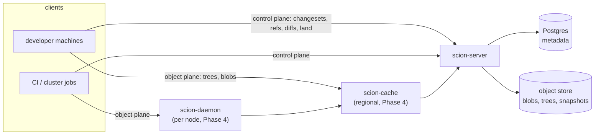

# Scion

**Client-server source control for agent-scale monorepos.**

> **Status: pre-MVP, Phase 3 (the MVP) in progress.** Phases 0–2 are merged: data model and
> canonical encoding, Postgres + S3 stores, derived data, diff / merge-base / merge / rebase.
> Phase 3.1–3.6 are merged: `scion-server` serves the object and control gRPC services
> (`log`, `diff`, `path_log`, `merge_base`, `blame`, `create_changeset`, `move_ref`), and the
> `scion-client` library can clone and sparse-checkout a working copy. There is **no `scn` CLI
> yet**, and the cache/daemon tiers (Phase 4) do not exist. Nothing here is usable by end users.

Scion is *not* a general replacement for git. Git's distributed, offline-first model is the right
design for the overwhelming majority of repositories. Scion targets one specific situation: a
single very large monorepo whose clients — CI jobs, agent sandboxes, research jobs, developer
environments — are effectively always online, and whose commit rate is driven by coding agents
rather than people. In that situation a decentralized model becomes the bottleneck, and a
centralized, server-authoritative design with thin clients and tiered object caches is a better fit.

This is an independent open-source project inspired by the design described in Anthropic's
engineering post [*Redesigning source control at Anthropic*](https://www.anthropic.com/engineering/redesigning-source-control).
It is not affiliated with or endorsed by Anthropic. The name may change before the first release.

## Why it is different

- **Postgres + S3, nothing else.** Metadata (changesets, refs, derived-data pointers) lives in
  Postgres; blobs, trees and snapshot manifests live in any S3-compatible object store. No
  packfiles, no repository maintenance, no materialized repository copy on any server.
- **Derived data instead of a richer commit.** A changeset records only what changed against its
  first parent. Trees, path history, blame and the ancestry skip list are computed from it and
  can be replaced without a client change.
- **Strict tiering** *(planned, Phase 4)*: daemon → regional cache → server, every request an
  immutable-id GET, no tier skipping a level even as a fallback.
- **Deliberate deviations from the reference design:** trees live in the object store rather
  than the metadata database ([why](docs/DATA_MODEL.md#deviation-trees-in-the-object-store));
  hashing uses our own canonical BLAKE3 encoding, never protobuf; the only server refs are
  `main` and `release/*`.

Target architecture (in the MVP, clients talk to `scion-server` directly):



## Design in one paragraph

A **changeset** is the unit of work: commit metadata plus a flat list of files changed relative to
the first parent, each pointing at a content-addressed blob. Changesets are created on the server
and appended to a write-ahead log; there is nothing to push. Directory **trees**, file history,
blame and commit-graph indexes are **derived data**, computed recursively from each changeset's
parents, and never stored in the changeset itself. Clients keep a bounded local object cache and
a sparse working copy, and resolve every tree and blob by immutable id through a strict cache
hierarchy — per-node daemon → regional cache → authoritative server — so every request is a
cacheable GET and no tier needs repository maintenance. Server-side refs are limited to `main` and
`release/*`; everything else is an anonymous head tracked by the client.

Full details: [`docs/ARCHITECTURE.md`](docs/ARCHITECTURE.md) and
[`docs/DATA_MODEL.md`](docs/DATA_MODEL.md).

## Prior art

- Google **Piper** (and CitC) — centralized monorepo on Spanner.
- Meta **Sapling / Mononoke / EdenFS** — bonsai changesets, derived data, virtual checkouts.
- **jj (Jujutsu)** — anonymous heads, operations as first-class data.
- Microsoft **VFS for Git / Scalar** — virtualized and cache-served git.

## Roadmap

| Phase | Scope | Status |
|---|---|---|
| 0 | Workspace, CI, local storage stack, docs | done |
| 1 | Data model, canonical encoding, golden hashes, store traits + memory impl | done |
| 1 | Postgres metadata store, S3-compatible object store | done |
| 2 | Derived data (trees, path history, blame, skip lists), diff / merge-base / rebase / merge | planned |
| 3 | `scion-server` (gRPC) + `scn` CLI — the MVP | planned |
| 4 | `scion-cache` and `scion-daemon` tiers, manifest-based seeding | post-MVP |
| 5 | Server-side rebase/merge UX, change requests, serial land worker | post-MVP |
| 6 | git → Scion ingestion | post-MVP |
| 7 | IAM (GitHub device-flow login, service principals, repo + directory ACLs), fuzzing, hermetic simulation | post-MVP |
| 8 | Virtualized checkouts (FUSE / NFS) | post-MVP |

## Development

```sh
# toolchain is pinned by rust-toolchain.toml; scion-proto also needs `protoc` on PATH
cargo test --workspace
cargo clippy --workspace --all-targets -- -D warnings

# local storage backends (Postgres + an S3-compatible server) for integration tests
docker compose -f deploy/docker-compose.yml up -d
cargo test -p scion-store --features integration
```

Golden-hash fixtures live in `crates/scion-types/tests/golden/`. They are the format
specification's executable form; see `docs/DATA_MODEL.md` before touching them.

## License

Apache-2.0. See [`LICENSE`](LICENSE).
