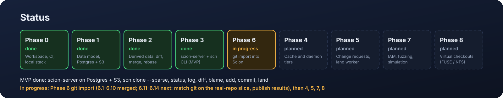

<p align="center">
  
</p>

<p align="center">
  <a href="https://github.com/tekeburak/scion/actions/workflows/ci.yml"></a>
  <a href="LICENSE"></a>
  <a href="#status"></a>
</p>

<p align="center"><b>A server-authoritative source control system for one very large monorepo whose
clients are always online and whose commits come mostly from coding agents.</b></p>

**Why it is different** ([details](docs/ARCHITECTURE.md)): metadata in Postgres and every object in S3, with no
packfiles and no materialized repository copy anywhere · trees, history, blame and ancestry are
derived data, so a commit costs what it changes · strict daemon → cache → server tiering, and
deliberate deviations from the reference design (trees in S3, canonical BLAKE3, only `main` and `release/*`).

<p align="center">
  
</p>

## Status

<p align="center">
  
</p>

**MVP (Phase 3) done; git import (Phase 6) in progress. Not production-ready: no auth, no cache tiers.**

- **Works today:** `scion-server` serves the object and control gRPC services over Postgres +
  S3 (`log`, `diff`, `path_log`, `merge_base`, `blame`, `create_changeset`, `move_ref`), and the
  `scn` CLI can `clone --sparse`, `status`, `log`, `diff`, `blame`, `add`, `commit` (an anonymous
  head) and `land` (fast-forward `main`). CI runs that loop end to end on Postgres + S3.
- **Git import (Phase 6.1–6.8 and 6.11 merged):** `scion-ingest import <git-dir> <repo> [<rev>]` turns a
  git history into changesets (first-parent file changes, renames and copies as `copy_from`,
  the git sha kept in `extra`), resumes from checkpoints, syncs incrementally and refuses a
  rewritten upstream; `scion-ingest verify` compares every imported tree with `git ls-tree`.
  Changesets are created in batches, so importing the benchmark's 600-commit slice takes about
  6× git's push when its objects are already in the bucket and about 19× into an empty bucket.
- **Real-repository benchmark (Phase 6.9–6.13 merged):** `scripts/bench-real` rebuilds a
  pinned slice of a real repository's history and times import, clone, sparse clone, `status`,
  `log`, `blame` and `land` against git on Postgres + S3, with `log` and `blame` measured cold
  (first call) and warm; the results are under [Benchmarks](#benchmarks). Clone, `status`,
  warm `log` and `blame` and commit + `land` run at or below git's time; cold, a path `log`
  takes about 7× git's and a `blame` about 3.5×.
- **Next:** an import how-to (6.14), then the steps that make the MVP usable by a
  team on one machine: bounded derivation with `backfill` (6.15), `scn init` (6.16),
  `scn update` and `scn checkout` (6.17), idempotent writes and a compose service for the
  server (6.18). After that: change requests and the land worker (Phase 5), IAM (Phase 7),
  release binaries and a quickstart (Phase 9), the cache and daemon tiers (Phase 4) and
  virtualized checkouts (Phase 8).

Scion is *not* a general replacement for git. Git's distributed, offline-first model is the right
design for the overwhelming majority of repositories. Scion targets one specific situation: a
single very large monorepo whose clients — CI jobs, agent sandboxes, research jobs, developer
environments — are effectively always online, and whose commit rate is driven by coding agents
rather than people. In that situation a decentralized model becomes the bottleneck, and a
centralized, server-authoritative design with thin clients and tiered object caches is a better fit.

This is an independent open-source project inspired by the design described in Anthropic's
engineering post [*Redesigning source control at Anthropic*](https://www.anthropic.com/engineering/redesigning-source-control).
It is not affiliated with or endorsed by Anthropic. The name may change before the first release.

## Why it is different, in detail

- **Postgres + S3, nothing else.** Metadata (changesets, refs, derived-data pointers) lives in
  Postgres; blobs and trees (and, from Phase 4, snapshot manifests) live in any S3-compatible object store. No
  packfiles, no repository maintenance, no materialized repository copy on any server.
- **Derived data instead of a richer commit.** A changeset records only what changed against its
  first parent. Trees, path history, blame and the ancestry skip list are computed from it and
  can be replaced without a client change. Commit cost follows the change, not the repository:
  one changed file in a 2,500-file tree rewrites 5 tree nodes, the directories on its path
  (asserted in `scion-derived`'s `rewritten_nodes_bounded_by_depth_not_file_count` test).
- **Strict tiering** *(planned, Phase 4)*: daemon → regional cache → server, every request an
  immutable-id GET, no tier skipping a level even as a fallback.
- **Deliberate deviations from the reference design:** trees live in the object store rather
  than the metadata database ([why](docs/DATA_MODEL.md#deviation-trees-in-the-object-store));
  hashing uses our own canonical BLAKE3 encoding, never protobuf; the only server refs are
  `main` and `release/*`.

<p align="center">
  
</p>

<p align="center">
  
</p>

The figures are generated by [`scripts/render-assets.py`](scripts/render-assets.py) (Python
standard library only); edit the script, not the SVGs.

## Benchmarks

### A real repository

[`scripts/bench-real`](scripts/bench-real) rebuilds 600 first-parent commits of a real
project's `library/` directory as a linear history. It imports that history into git and into
Scion on the compose stack (Postgres + an S3-compatible server, with `scion-server` on
loopback), then times each workload with both tools. git runs its history workloads in a full
clone, its best case. `scn` runs them in a sparse clone of `core/`, its normal case. Every
checkout is compared byte for byte outside the timers. `log` and `blame` are timed twice:
cold (the first call after import, with nothing cached on the server) and warm.

<p align="center">
  
</p>

<!-- bench-real:start (scripts/render-assets.py writes this table) -->
| Workload | git, ms | scion, ms | scion / git |
| --- | ---: | ---: | ---: |
| import | 1,463 | 7,919 | 5.4× |
| clone | 1,691 | 564 | 0.33× |
| sparse clone | 547 | 70 | 0.13× |
| status | 226 | 10 | 0.04× |
| path log, cold | 27 | 199 | 7.4× |
| path log, warm | 24 | 24 | 1.0× |
| blame, cold | 57 | 197 | 3.5× |
| blame, warm | 59 | 11 | 0.19× |
| commit + land | 45 | 34 | 0.76× |

Repository: library/ of the public repository pinned in scripts/bench-real, first-parent commits since 2026-01-01 up to 91e9c2688eb23af9a5b77f056156e756550c7c99 (600 commits, 2330 files at the tip).  
Machine: Linux 6.18.44-fc-v139 x86_64; Intel(R) Xeon(R) Processor @ 2.10GHz; 4 cpus; 15 GiB.  
Run: git version 2.43.0; scion a0c0c7e; 3 runs; 2026-10-17T13:25:51Z.  
Other implementations of the design: not measured in this run.
<!-- bench-real:end -->

Read these numbers with their limits:

- **Import** writes one immutable object per blob, tree and history page to a remote object
  store, where git writes a local packfile. The 6.11 criterion is ten times git, not parity.
  The script reuses one bucket across runs, so this row imports objects that are already
  stored (warm). Into an empty bucket it is about three times slower; Phase 6.18 measures
  that cold case separately.
- **Cold `log` and `blame`** pay one object-store round trip per pointer hop, which git's
  local packfile never does. The 6.12 criteria bound them at 20× and 5× git.
- One machine, three runs, shared cloud VM: medians move by several milliseconds between
  runs. The CSV with every sample is [docs/bench-real.csv](docs/bench-real.csv); render it with
  `python3 scripts/render-assets.py`.

### Synthetic workloads

The [benchmark runner](crates/scion-client/examples/benchmark.rs) compares Scion with git on
four synthetic workloads: directory import, a one-file commit, a full clone and a
one-directory clone.

Medians measured 2026-10-15 on a 4-vCPU Intel Xeon @ 2.80 GHz cloud VM with 15 GiB RAM,
Linux 6.18, Rust 1.97.0 and git 2.43.0, at commit `b9a8eb4` plus the runner. Each file holds
4 KiB of seeded pseudorandom bytes, spread across 10 directories. The 1,000-file case uses
seven runs and the 10,000-file case uses five. All times are in milliseconds; lower is better.

| Scenario | Git, 1k files | Scion, 1k | Git, 10k files | Scion, 10k |
| --- | ---: | ---: | ---: | ---: |
| Import directory | 492.4 | 111.8 | 4,021.3 | 1,230.4 |
| Commit one changed file | 28.5 | 1.8\* | 35.5 | 3.5\* |
| Full clone / checkout | 806.4 | 529.0 | 7,371.8 | 5,113.5 |
| One-directory clone / checkout | 417.7 | 144.1 | 1,089.8 | 304.5 |

Read these numbers with their limits:

- **\*Commit is not like-for-like yet.** The runner predates `scn commit` (Phase 3.8), so the
  Scion figure times only the server side: `PutBlob` + `CreateChangeset` (with eager derivation) +
  `MoveRef`. `git commit -a` also scans the working copy. Treat this row as a lower bound for
  Scion.
- **Storage.** The server runs in-process over loopback gRPC (plain HTTP/2, no TLS) with the
  **in-memory** store, not Postgres + S3. Git clones over the local filesystem (`--no-local`;
  `file://` with `--filter=blob:none --sparse` for the one-directory case).
- **No cache tier.** The client talks to `scion-server` directly. OS page caches are not
  flushed between runs.
- These are synthetic local measurements of this implementation, not production throughput.

What each workload does:

- **Import:** git runs `init` + `add -A` + `commit`. Scion reads every file, uploads its blob
  (64 in flight), then calls `CreateChangeset` and `MoveRef` to create `main`.
- **Full clone:** `git clone --no-local` against `scion_client::clone` with the full profile.
- **One-directory clone:** a git partial clone plus `sparse-checkout set dir0000`, against
  `scion_client::clone` with a one-directory sparse profile. Scion fetches only the trees on
  the path and the blobs beneath it.
- Every checkout is verified byte for byte outside the timers.

Reproduce (needs git and `protoc` on `PATH`):

```sh
cargo run --release -p scion-client --example benchmark -- 100 7    # 1,000 files
cargo run --release -p scion-client --example benchmark -- 1000 5   # 10,000 files
cargo run --release -p scion-client --example benchmark -- 2 1      # quick smoke run
```

## Design in one paragraph

A **changeset** is the unit of work: commit metadata plus a flat list of files changed relative to
the first parent, each pointing at a content-addressed blob. Changesets are created on the server
and appended to a write-ahead log; there is nothing to push. Directory **trees**, file history,
blame and commit-graph indexes are **derived data**, computed recursively from each changeset's
parents, and never stored in the changeset itself. Clients keep a bounded local object cache and
a sparse working copy, and resolve every tree and blob by immutable id through a strict cache
hierarchy — per-node daemon → regional cache → authoritative server — so every request is a
cacheable GET and no tier needs repository maintenance. Server-side refs are limited to `main` and
`release/*`; everything else is an anonymous head tracked by the client.

Full details: [`docs/ARCHITECTURE.md`](docs/ARCHITECTURE.md) and
[`docs/DATA_MODEL.md`](docs/DATA_MODEL.md).

## Scope

- **Target:** one server serving many repositories, with Linux and macOS clients that are
  always online.
- **Planned, not built:** the cache and daemon tiers (Phase 4), change
  requests and the serial land worker (Phase 5), and IAM (Phase 7). Git import (Phase 6) is
  in progress: the importer works and the real-repository benchmark results are under
  [Benchmarks](#benchmarks).
- **Out of scope for now:** git wire compatibility, offline operation, Windows, a review UI,
  garbage collection, large-file chunking (there is a per-blob size limit) and ignore files. See
  [`docs/FAQ.md`](docs/FAQ.md#what-is-scion-not-a-good-fit-for).

## Project map

| Area | Crates |
|---|---|
| Format | `scion-types`: ids, changesets, trees, the canonical encoding and golden hashes |
| Storage | `scion-store`: `MetadataStore` / `ObjectStore` traits; memory, Postgres and S3 implementations |
| Algorithms | `scion-derived` (root tree, path history, blame, skip list), `scion-core` (diff, log, merge-base, merge, rebase), `scion-diff3` |
| Network | `scion-proto` (gRPC schema), `scion-server` (control plane and object origin) |
| Client | `scion-client`: `.scn/` layout, index, sparse profile, clone, checkout and commit; `scn`: the CLI |
| Import | `scion-ingest`: git → Scion importer (`import`, `verify`), checkpoints and incremental sync |

## Prior art

- Google **Piper** (and CitC) — centralized monorepo on Spanner.
- Meta **Sapling / Mononoke / EdenFS** — bonsai changesets, derived data, virtual checkouts.
- **jj (Jujutsu)** — anonymous heads, operations as first-class data.
- Microsoft **VFS for Git / Scalar** — virtualized and cache-served git.

## Roadmap

| Phase | Scope | Status |
|---|---|---|
| 0 | Workspace, CI, local storage stack, docs | done |
| 1 | Data model, canonical encoding, golden hashes, store traits + memory impl | done |
| 1 | Postgres metadata store, S3-compatible object store | done |
| 2 | Derived data (trees, path history, blame, skip lists), diff / merge-base / rebase / merge | done |
| 3 | `scion-server` (gRPC) + `scn` CLI — the MVP | done |
| 6 | git → Scion ingestion, benchmarks on a real repository, `scn init` / `update` / `checkout`, bounded cold derivation | in progress |
| 5 | Server-side rebase/merge UX, change requests, serial land worker | post-MVP |
| 7 | IAM (GitHub device-flow login, service principals, repo + directory ACLs), fuzzing, hermetic simulation | post-MVP |
| 9 | Release and onboarding: versioned binaries, server image, production compose profile, five-minute quickstart | post-MVP |
| 4 | `scion-cache` and `scion-daemon` tiers, manifest-based seeding | post-MVP |
| 8 | Virtualized checkouts (FUSE / NFS) | post-MVP |

Phases run in table order: git import comes right after the MVP because testing and
benchmarking against real repositories needs it; the land worker and IAM come before any
release, so a released server handles concurrent writers and authenticates them; the cache
and daemon tiers wait until there is more than one machine to serve. From Phase 6 on, each
phase's single-PR steps go into `docs/ROADMAP.md` when the phase starts.

## Development

```sh
# toolchain is pinned by rust-toolchain.toml; scion-proto also needs `protoc` on PATH
# scion-ingest's tests also need `git` on PATH (apt-get install git / brew install git)
# scripts/bench-real also needs openssl and curl (apt-get install openssl curl / brew install openssl curl)
cargo test --workspace
cargo clippy --workspace --all-targets -- -D warnings

# local storage backends (Postgres + an S3-compatible server) for integration tests
docker compose -f deploy/docker-compose.yml up -d
cargo test -p scion-store --features integration
cargo test -p scn --features integration --test e2e_stack   # scn + scion-server end to end

# Scion against git on a pinned slice of a real repository's history (needs network, git
# and Docker; the script header names the slice);
# writes target/bench-real/results.csv
scripts/bench-real 3
```

Golden-hash fixtures live in `crates/scion-types/tests/golden/`. They are the format
specification's executable form; see `docs/DATA_MODEL.md` before touching them.

## License

Apache-2.0. See [`LICENSE`](LICENSE).
